# 📊 UIII Act3: Importación y Descripción de Datos
## Axel Guzman NC 0070
> **📈 Dificultad:** Cero a principiante  
> **🐍 Lenguaje:** Python  
> **🛠️ Herramientas:** Visual Studio Code, Pandas, Matplotlib y CSV  
## tabla original de empleados
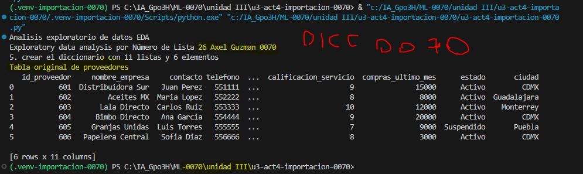
# provedores de trabajo

## 7 convertir el dataframe en arcivo CSV
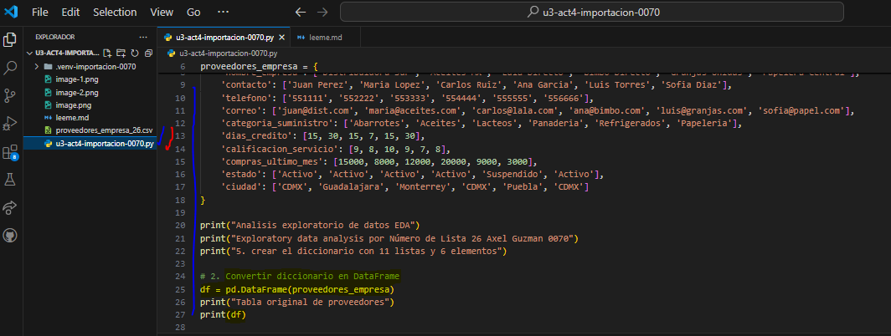
## datos en CVS > base de datos
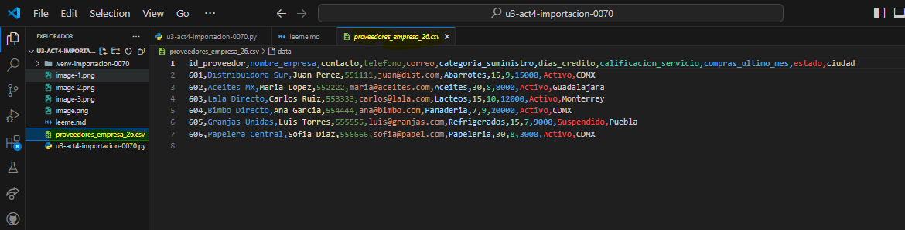
## leer los datos desde el archivo CVS
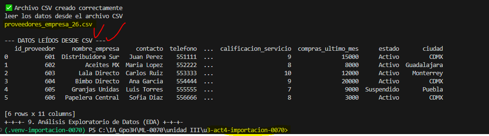
## 9. Análisis Exploratorio de Datos (EDA)
### primeros y ultimos registros
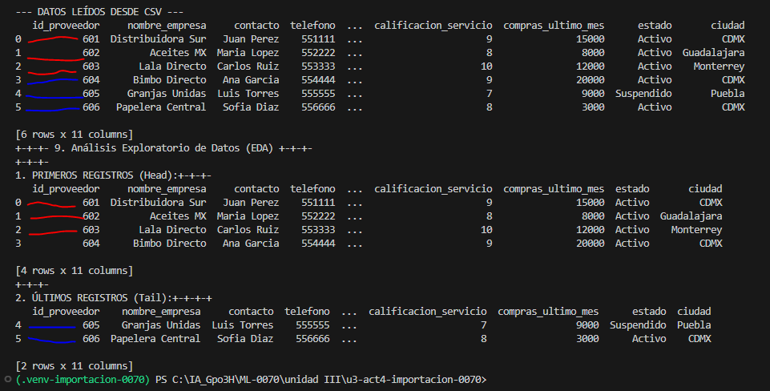
## 6. dimensiones y estructura
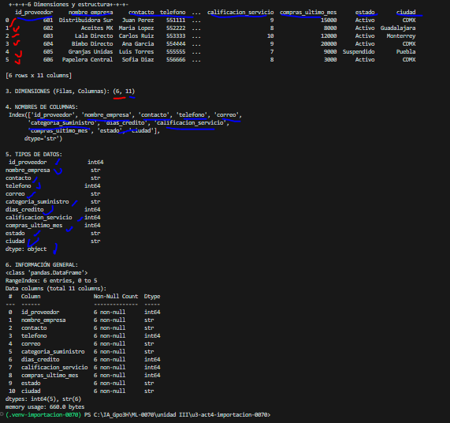
## 7 estadisticas y limpieza
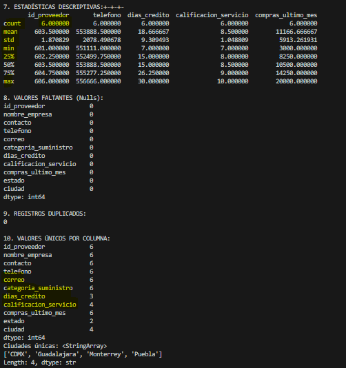
# 8 y 9 ordemamiento, filtrado y agrupacion

# 18. Gráfica de barras: Proveedores por ciudad
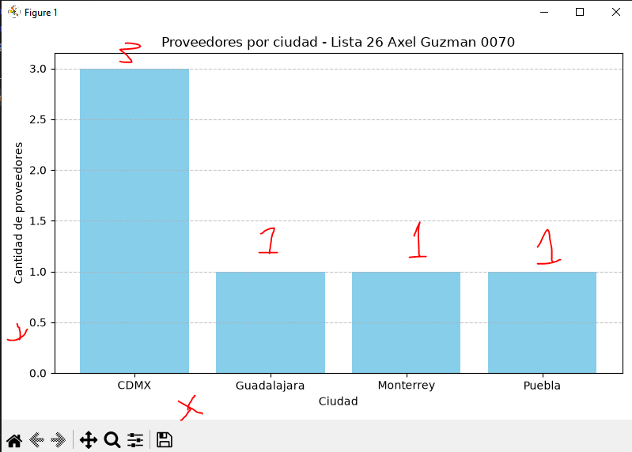
# 19. Gráfica de barras: Compras del último mes por empresa
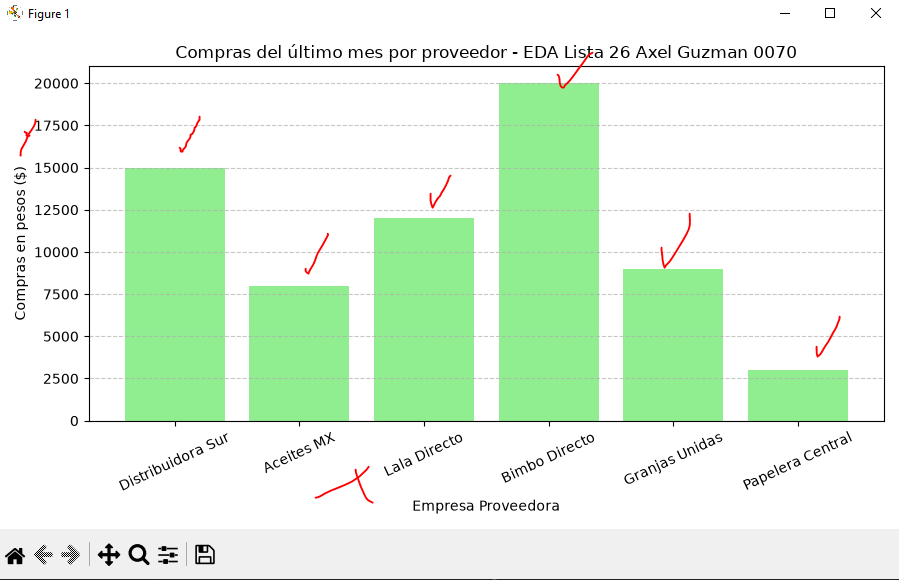
# 20. Histograma: Distribución de días de crédito
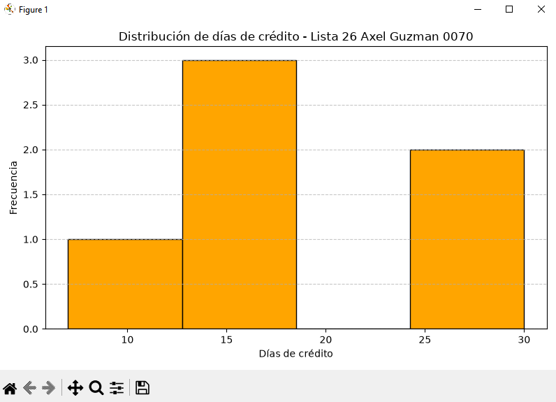
# 21. Gráfica de dispersión: Calificación de servicio vs Compras del último mes
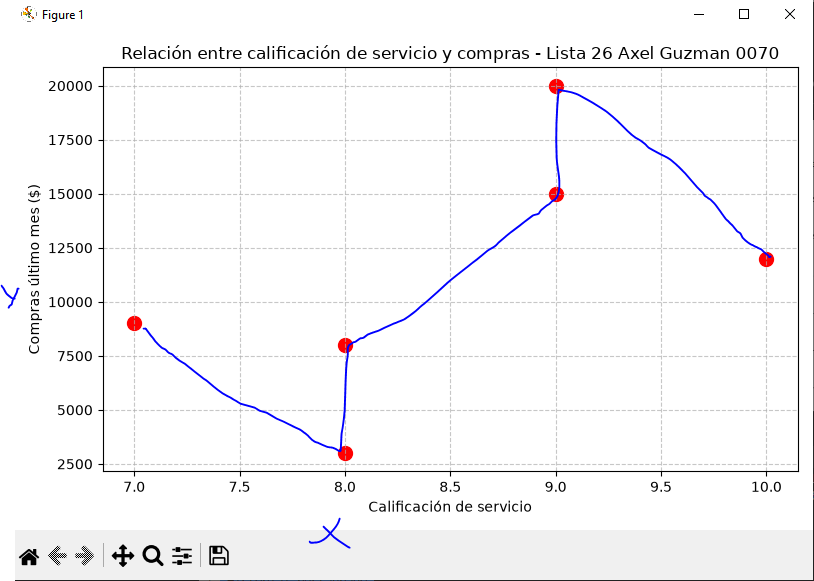
# 22. Diagrama de caja: Distribución de compras del último mes
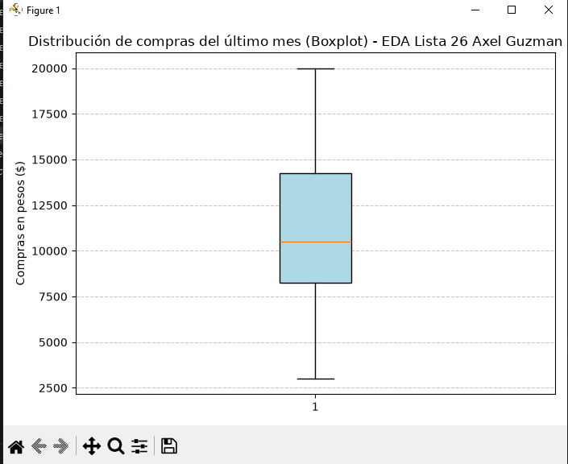
# 23. Matriz de correlación
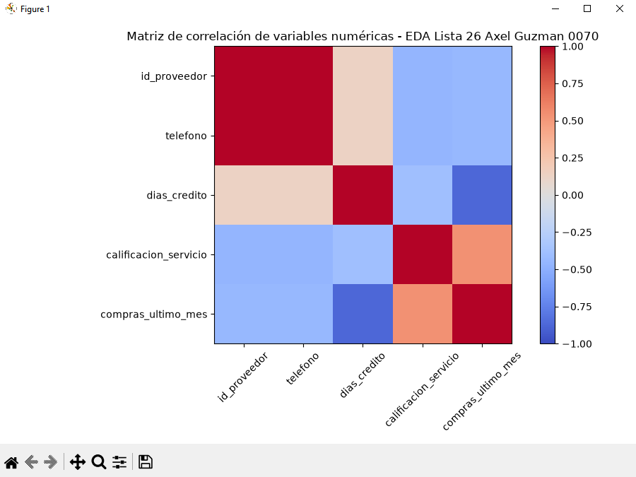